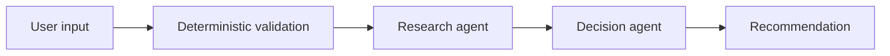

# Household Agent

An AI-assisted application that researches replacement guidance for everyday household products and returns an evidence-backed recommendation—or clearly explains why a defensible recommendation is not possible.

## Application Demo


*A successful, evidence-backed recommendation based on the product's reported condition.*


*The input screen requires only a product name, with optional context for a more specific recommendation.*


*When product details are too limited, the application explains the uncertainty and suggests a practical next step.*

## Architecture



### Engineering highlights

- Structured outputs at both agent boundaries
- Deterministic request and response validation
- Explicit failure handling and abstention paths
- Automated component, API, and regression testing

> 🚧 **Status:** V1 Impelented
Household Agent V1 is a stateless FastAPI application that researches household-product replacement guidance and returns one of six evidence-backed outcomes. It keeps research collection separate from decision reasoning, validates both agent boundaries, and never turns malformed model output into a recommendation.
## The Problem

Deciding whether to replace a pan, water bottle, or another reusable household item can require finding manufacturer instructions, interpreting condition-based guidance, comparing general sources, and accounting for missing or conflicting information. Household Agent aims to reduce that research and decision-making effort without inventing product facts or replacement schedules.

## V1 Experience

The user enters a **product name** (required). **Purchase date, product link, and notes** are optional.

The application returns one of six outcomes:

- **Replace**
- **Not yet**
- **Condition dependent**
- **Insufficient evidence**
- **Unresolved evidence conflict / abstain**
- **Insufficient product information**

The result leads with the outcome and explains the reasoning, the specific uncertainty (if any), and the evidence and source links used. An explicit product expiration date takes precedence over inventing an age-based schedule. Purchase date alone does not prove the item's condition.

## Requirements

- Python 3.12+
- An OpenAI API key for live recommendations

The live implementation uses the Responses API with hosted web search for research and a separate, non-searching decision call. External calls have a configurable timeout and SDK retries are disabled so malformed or failed calls remain observable.

## Setup

```bash
python3.12 -m venv .venv
source .venv/bin/activate
pip install -e '.[test]'
```

Set `OPENAI_API_KEY` in `.env` or the process environment. Never commit a real key.

Configuration variables:

- `HOUSEHOLD_AGENT_RESEARCH_MODEL` and `HOUSEHOLD_AGENT_DECISION_MODEL`
- `HOUSEHOLD_AGENT_PROVIDER_TIMEOUT_SECONDS`
- `HOUSEHOLD_AGENT_MAX_SEARCH_QUERIES`
- `HOUSEHOLD_AGENT_MAX_EVIDENCE_SOURCES`
- `HOUSEHOLD_AGENT_LOG_LEVEL` (`INFO` by default)

The query limit is included in the Research Agent's bounded task; the source limit is also enforced on its returned evidence. Provider-side web-search behavior remains subject to the provider's API.

At `INFO`, logs include raw Research and Decision agent outputs, provider input/output/total token usage, validated outcome/count summaries, and controlled error scenarios. API keys and authorization headers are never logged. Agent outputs can contain product notes or retrieved source text, so production operators should apply appropriate log access and retention controls.

## Run

```bash
uvicorn household_agent.app:app --reload
```

Open `http://127.0.0.1:8000/` for the minimal UI or POST JSON to `/api/v1/recommendations`:

```json
{
  "product_name": "ceramic nonstick pan",
  "purchase_date": "2021-06-01",
  "product_url": null,
  "notes": "coating is visibly peeling"
}
```

Only `product_name` is required. Unknown facts stay unknown, and the application does not ask follow-up questions.

## Test

```bash
pytest
```

Tests use mocked providers and frozen evidence; they never fabricate a successful live-provider response. The suite covers component contracts, provider-call behavior, pipeline ordering, API behavior, evidence joins, and EV-01–EV-25. Live retrieval should be tested separately with a real key because deterministic fixtures cannot verify current source accessibility or model reasoning quality.

## Failure semantics

- Invalid request input: HTTP 422
- Malformed research or decision output, including invalid claim references: HTTP 502
- Provider/research unavailable: HTTP 503
- Valid empty evidence: a normal `Insufficient evidence` result, not an error

The API returns only evidence claims referenced by the validated decision. Validators enforce structure and mechanical consistency; they do not certify factual truth, credibility, independence, or semantic reasoning.

## Structure

- `src/household_agent/contracts.py` — Pydantic contracts
- `src/household_agent/validation.py` — deterministic boundary validators
- `src/household_agent/agents.py` — Research and Decision agents/prompts
- `src/household_agent/provider.py` — provider adapter
- `src/household_agent/service.py` — sequential orchestration and evidence join
- `src/household_agent/app.py` — FastAPI routes and minimal UI
- `schemas/` — language-neutral JSON contracts
- `tests/` — component, API, and EV regression tests

The provider adapter follows the official OpenAI [web search guide](https://developers.openai.com/api/docs/guides/tools-web-search) and [Responses API reference](https://developers.openai.com/api/reference/python/resources/responses/methods/create).

## Documentation

Detailed design records live in [`docs/`](docs/):

- [`project-overview.md`](docs/project-overview.md) — problem, goals, and scope
- [`requirements.md`](docs/requirements.md) — functional and non-functional requirements
- [`architecture.md`](docs/architecture.md) — pipeline, agent responsibilities, and draft contracts
- [`evaluation-plan.md`](docs/evaluation-plan.md) — acceptance and regression scenarios
- [`decision-log.md`](docs/decision-log.md) — accepted choices and superseded directions
- [`implementation-plan.md`](docs/implementation-plan.md) — phased delivery plan
