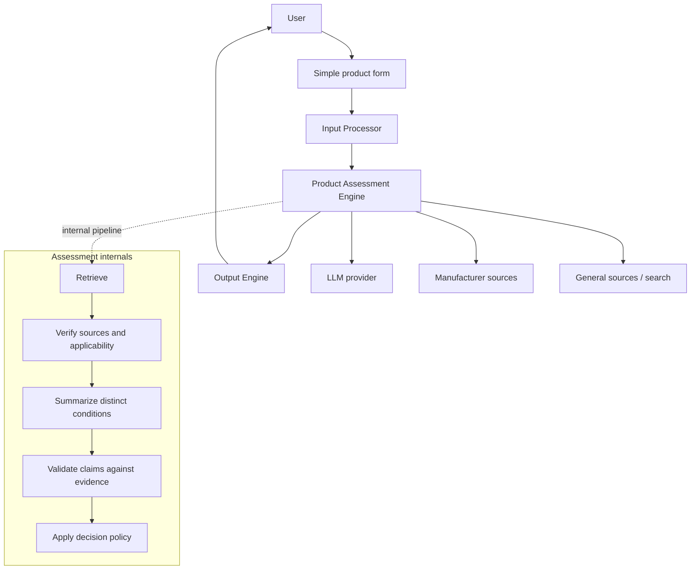

# Household Product Lifecycle Agent — High-Level Architecture

**Version:** 1.1 (V1 design)  
**Updated:** 2026-10-13  
**Status:** Agreed high-level direction; implementation details pending low-level design

## 1. Purpose and V1 Scope
Provide evidence-informed guidance on whether a household product should be replaced, retained, checked for expiration, or evaluated conditionally. Explain the decision, why it was reached, and which sources support it, without inventing unknown product facts.

**In scope:** Manual product entry, source research, manufacturer/general guidance assessment, condition and date-aware decisions, transparent evidence and useful next steps.

**Out of scope:** Accounts, automated purchase import, reminders, component-level tracking, and separately deployed microservices.

## 2. Architecture

V1 is a **modular monolith** with **three logical components**. A thin application controller invokes them in sequence; no dedicated orchestrator or standalone Decision Engine is needed.

The internal stages are logical steps, not separate services. The LLM supports research interpretation and summarization; its unsupported claims are not accepted as evidence.

## 3. Components

### 3.1 Input Processor
- **UI:** Simple form with **product name (required)**, **purchase date (optional)**, and **notes (optional)**. The UI is not the processor itself.
- Validate and normalize fields into a structured request. A nonempty broad name such as `pan` is valid.
- Do not classify product types, infer material/brand/condition, or conduct evidence research. Preserve notes without assuming their meaning.
- Missing product name produces a validation error. Do not demand extensive up-front clarifications.

### 3.2 Product Assessment Engine
- Receive product name, optional purchase date, and optional notes. Use all available context to frame the question **whether replacement is appropriate**, but do not treat purchase age alone as a universal replacement rule.
- Identify likely product category/branches when the name is broad (e.g., `pan`).
- **Manufacturer-first research:** Look for applicable manufacturer guidance and verify the actual source, claims, and model/product applicability. If applicable manufacturer guidance adequately resolves the question, it can be sufficient; otherwise research credible general guidance.
- Treat an inaccessible manufacturer page as **unreachable**, not proof that guidance does not exist. Retry a limited number of times (working proposal: up to two retries) before fallback; exact retry policy remains for LLD.
- If no specific brand/model is known, guidance from multiple manufacturers may inform **general category guidance**, but must not be mislabeled as manufacturer guidance for the user's own item.
- Use an LLM to summarize evidence while retaining distinct conditions and source attribution. Validate each summarized condition against the retrieved evidence; omit unsupported conditions rather than discarding all supported findings.
- Apply evidence priority, user notes, purchase date when relevant, explicit expiration criteria, applicability, and conflict/abstention rules **within this same component**.
- Output a structured **decision, reasoning, evidence references, and relevant notes/uncertainty**. If the facts are unknown, output conditional guidance instead of pretending they are known. If material credible conflicts cannot be reconciled, abstain and explain the conflict.
- **Important:** A source stating “replace if peeling” does not, by itself, prove “do not replace if not peeling.” Any `Not yet` outcome requires affirmative support from applicable evidence, not merely absence of a trigger.

### 3.3 Output Engine
- Present in this order: **Decision → Reasoning → Evidence (source links)**.
- Show relevant conditions, caveats, and concise notes as needed.
- When evidence or product information is insufficient, say what is missing and what the user could provide next time.
- Never change the assessment, invent sources, or independently decide replacement.

## 4. Main Flow
1. User enters product name, optional purchase date and notes in a form.
2. Input Processor validates and normalizes the fields.
3. Product Assessment Engine classifies as necessary, researches and verifies evidence, summarizes and validates conditions, then determines the decision using the product context.
4. Output Engine renders decision, reasoning, evidence links, and any missing-information guidance.

**Ambiguous example:** `pan` is accepted. The assessment may provide separate conditional guidance for stainless steel, ceramic-coated, and cast iron rather than forcing a material-selection question.

**Condition example:** If guidance says replace upon peeling and the user provides no condition notes, return `Condition dependent — replace if peeling`. If notes mention only light scratches and no peeling, do **not** infer `Not yet` solely from that one-sided instruction; use other applicable evidence to support any firmer outcome.

## 5. Decision and Evidence Principles
- Applicable verified manufacturer guidance takes priority over generic guidance; exact applicability matters.
- Manufacturer guidance can suffice alone when it directly resolves the case. Otherwise fall back to credible general guidance, subject to evidence quality rules.
- General guidance should be supported by at least two independent credible sources when used to justify a firm recommendation (carried forward from the earlier product decision log).
- Preserve conditions, scope, source URLs, and any disagreements. Do not majority-vote away irreconcilable conflicts.
- If no reliable basis exists, return insufficient evidence or unresolved conflict, with an explanation.
- Distinguish lack of accessible evidence from evidence of absence.
- No numeric confidence score in V1.

## 6. Illustrative Contracts (not finalized)
- `ProductRequest`: `productName` (required string), `purchaseDate?`, `notes?`.
- `AssessmentResult`: `decision`, `reasoning`, `evidence[]` (claims, provenance, URLs, applicability), `notes?`, `uncertainty?`, `missingInformation?`.
- `UserResponse`: formatted decision, reasoning, cited links, relevant notes/next action.

Final types, enum states, schemas, prompts, search integrations, verification algorithm, and failure behavior belong in LLD.

## 7. Open Design Questions
- Language, framework, deployment and whether any storage is needed.
- Date parsing/validation, UI behavior, precise schemas and decision enum.
- LLM provider, search provider, source authenticity and claim validation mechanisms.
- Manufacturer applicability criteria; research stopping rules; timeout and retry configuration.
- Source quality thresholds, conflict-resolution details and safety-sensitive products.
- Tests, monitoring, privacy, caching and graceful degradation.

## 8. Architecture Evolution
Keep the Product Assessment Engine internally structured and testable. Revisit separate deployable services only if an actual reuse or operational need emerges. The previously proposed four-component architecture was **superseded** by the three-component design; see the Architecture Decision Log.
