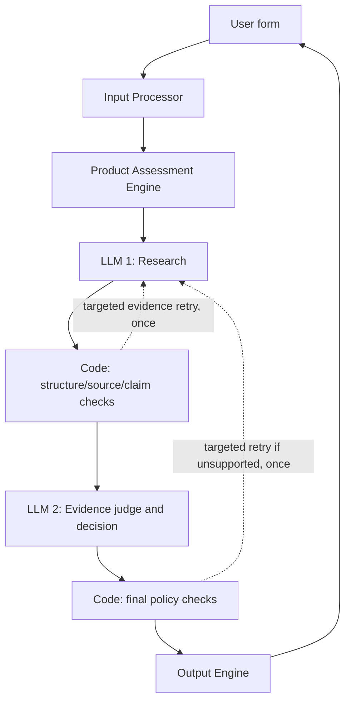

# Household Product Lifecycle Agent — Low-Level Design

**Version:** 0.1 (draft for review)  
**Date:** 2026-10-13  
**Status:** Captures agreed V1 design; unresolved details explicitly marked

## 1. Purpose and scope
Implement a V1 household-product replacement assessment using a modular monolith. The system accepts a product name and optional purchase date and notes, researches credible replacement guidance, validates claims, makes an evidence-based decision, and explains the decision with source links.

Out of scope: user accounts, automated purchase imports, recurring monitoring, component-level tracking, and independently deployed microservices.

## 2. Architecture



These are logical steps in one application, not separate network services. A thin application controller invokes the three modules in order. Retry paths are bounded; they do not loop indefinitely.

## 3. Input Processor

### User interface
A simple form with:

| Field | Required | Validation | Handling |
|---|---|---|---|
| Product name | Yes | Non-empty after trimming whitespace | Preserve user wording, including broad names such as `pan` |
| Purchase date | No | Must be a valid date when supplied | Pass through or `null`; exact date representation TBD |
| Notes | No | Text | Preserve condition, usage, and other user-provided details without inventing missing facts |

The form provides basic field-level validation. The Input Processor does **not** classify products or ask a lengthy preliminary questionnaire. It forwards broad product names to the assessment engine, which may produce conditional guidance.

### Conceptual input contract
```json
{
  "product_name": "ceramic pan",
  "purchase_date": "2022-01-15",
  "notes": "Light scratches; no peeling"
}
```

The example date is illustrative; no required date precision or handling of future dates has yet been agreed.

### Processing
1. Check that product name is present and not whitespace-only.
2. Validate purchase date only if provided.
3. Preserve product name and notes as entered (apart from any basic input hygiene required by the interface).
4. Pass structured input to Product Assessment Engine; return field-specific validation errors if invalid.

## 4. Product Assessment Engine

### 4.1 Responsibilities
Own research, evidence verification, evidence applicability, conflict handling, and final decision. Keep research and decision logic as separate **internal steps** within the same engine. Both LLM calls receive the user's relevant product context, but the second model is constrained to verified evidence.

### 4.2 Stage A — LLM 1: evidence research
A predefined, versioned research prompt supplies product name, optional purchase date, and optional notes and asks for evidence relevant to **when or whether the product should be replaced**.

Research order:
1. Seek exact-product/manufacturer guidance when the product can be identified.
2. If verified, applicable manufacturer guidance sufficiently resolves the question, general research is unnecessary.
3. If manufacturer guidance is missing, unreachable after bounded retries, or insufficient to answer, seek credible general guidance.
4. For broad names (e.g., `pan`), provide category-specific conditional claims without pretending they belong to the user's exact product.
5. Preserve distinct conditions as distinct claims. Do not merge `replace if peeling` and `replace if food sticks` into an unsupported universal rule.

Manufacturer guidance for another brand/model must **not** be labeled as exact-product guidance. It may be considered as category context only if clearly labeled and evaluated for applicability.

**LLM 1 returns research claims, not a final replacement decision.** Every claim must identify its source and relevant conditions. A URL alone is not proof that the cited page supports a claim.

### 4.3 Stage B — deterministic validation
Validate individual claims independently, retaining unrelated valid claims:
- **Schema:** required claim fields and a source URL are present; malformed or sourceless claims are rejected.
- **Source retrieval:** URL is reachable and its actual contents can be inspected. Unreachable is *unverified*, not proof that guidance does not exist.
- **Provenance:** manufacturer claims must be attributable to the actual manufacturer and applicable product/model; otherwise downgrade/relabel or reject as appropriate.
- **Independence:** multiple claims or URLs from the same underlying source do not count as multiple independent sources. Deduplicate by canonical document/source identity, not simply claim count.
- **Claim fidelity:** verify that quoted or summarized conditions are actually supported by source content; do not accept invented intervals or broadened conditions.
- **Evidence threshold:** exact, applicable manufacturer guidance may suffice alone. General-guidance decisions require **two credible independent sources** supporting compatible, applicable claims.

Some semantic checks (e.g., whether a paraphrase is truly entailed by a page) cannot be guaranteed by deterministic code alone; the second LLM evaluates these with the retrieved source passages. Code must still enforce objective rules and validate the final result.

If one of five claims lacks a source URL, discard **that claim**, not all five. If a claim essential to a decision fails, invalidate the proposed decision and reassess using surviving evidence.

### 4.4 Stage C — LLM 2: evidence judge and decision
Give the judge the structured user input, surviving claims, their verified source excerpts/links, source classifications, and validation results. Prompt constraints:
- Decide **only** from validated evidence and known user facts.
- Assess whether each claim actually supports the proposed criterion and whether it applies to this product; explain applicability in reasoning.
- Never infer the reverse of a conditional statement. For example, `replace if peeling` does not alone establish `not yet` when peeling is absent.
- Do not assume unreported conditions, product identity, or manufacture dates.
- Respect applicable manufacturer guidance over less specific general guidance.
- When credible material conflicts cannot be reconciled by scope or applicability, **abstain** and identify the conflicting claims and sources.
- If facts are missing, return a conditional answer where supported, or insufficient evidence/information with a concrete explanation.
- Return structured JSON, including the decision, reasoning, and references to supporting claim IDs.

The judge is a model-based semantic evaluator, **not** an independent guarantee of factual correctness. The prompt is a safeguard but not a substitute for final policy checks.

### 4.5 Stage D — final code policy checks
Before presenting a decision:
1. Verify output JSON schema and allowed decision status.
2. Verify every cited claim ID survived validation.
3. Verify that general-guidance decisions meet the two-independent-source threshold.
4. Reject a firm decision if its essential supporting claim is invalid or absent.
5. Reject unsupported inferences and unresolved material conflicts where identifiable; require abstention rather than unsupported certainty.
6. If a check fails, request one **targeted** retry to recover missing evidence or revise the unsupported decision. Reuse validated claims rather than redoing all research.
7. If retry fails, return `insufficient_evidence` with surviving evidence, specific gaps, and sources, not an unsupported replacement decision.

**Retry policy:** one targeted retry of a failed assessment/validation step was agreed. Separately, manufacturer source access can be retried up to two times before falling back to general guidance. Exact timeout/backoff values remain open.

### 4.6 Decision outcomes
| Status | Meaning |
|---|---|
| `replace` | Applicable validated evidence supports replacement for the stated facts |
| `not_yet` | Applicable validated evidence affirmatively supports retaining the product for now |
| `condition_dependent` | Evidence supports explicit conditional branches; required conditions are unknown or vary by product type |
| `check_expiration` | Product-specific labeled expiration is the governing criterion, but expiration information needs checking |
| `insufficient_evidence` | Validated evidence cannot justify a decision, including unresolved credible conflicts |
| `insufficient_product_information` | Product identity/detail is too ambiguous for meaningful guidance |

These are conceptual enum values; final public labels can differ. A conflict may be carried as a distinct machine-readable reason under `insufficient_evidence`, preserving the earlier product-level distinction between evidence shortage and unresolved conflict.

## 5. Illustrative structured contracts (not finalized schemas)

### LLM 1 output
```json
{
  "claims": [
    {
      "claim_id": "c1",
      "claim_text": "Replace if the coating is peeling",
      "condition": "coating is peeling",
      "source_url": "https://example.org/manufacturer-guidance",
      "source_type_claimed": "manufacturer",
      "product_scope": "specific product/model if verified",
      "supporting_excerpt": "Example excerpt to be verified against source"
    },
    {
      "claim_id": "c2",
      "claim_text": "Replace if food sticks",
      "condition": "food sticks",
      "source_url": "https://example.org/other-guidance",
      "source_type_claimed": "general",
      "product_scope": "category guidance",
      "supporting_excerpt": "Example excerpt to be verified against source"
    }
  ]
}
```

**Note:** URLs and excerpts above are placeholders, **not actual sources or validated guidance**.

### Validated claim representation
```json
{
  "claim_id": "c1",
  "validation_status": "validated",
  "verified_source_type": "manufacturer",
  "canonical_source_id": "source-1",
  "verified_excerpt": "Retrieved excerpt supporting the condition",
  "source_url": "https://example.org/manufacturer-guidance"
}
```

### Assessment result (LLM 2 + policy checks)
```json
{
  "decision": "condition_dependent",
  "reasoning": "Replacement depends on whether the verified condition is present; it was not provided.",
  "supporting_claim_ids": ["c1"],
  "missing_information": ["Whether the coating is peeling"],
  "evidence_conflict": false
}
```

Schema validation, citation integrity, and decision-support thresholds remain code responsibilities. The above examples establish direction, not a finalized API.

## 6. Output Engine
The Output Engine **formats** the assessment without changing the decision. Present:

1. **Decision** — `Replace`, `Not yet`, `Condition dependent`, `Check expiration`, or `Insufficient evidence/information`.
2. **Reasoning** — why the assessment reached this outcome, including relevant user facts and exact evidence conditions.
3. **Evidence** — links to the verified sources used, clearly labeling manufacturer-specific versus general guidance.
4. **Missing information / next action** — included in the reasoning when the assessment abstains or is conditional.

Do not expose hidden model chain-of-thought. Provide an auditable **decision rationale** grounded in evidence and policy, not private internal reasoning.

## 7. Worked scenarios

| Scenario | Expected behavior |
|---|---|
| Product `pan`, no other details | Return material-dependent conditional guidance if supported; do not guess material or force a questionnaire |
| Manufacturer says replace if peeling; user provides no condition | `condition_dependent`: replace if peeling; identify missing condition |
| Manufacturer says replace if peeling; user says light scratches, no peeling | `not_yet` **only if additional applicable evidence affirmatively supports it**; otherwise do not infer safety from the absence of peeling alone |
| General guidance: three claims from one page | Count as **one** independent source |
| Five claims, one has no URL | Reject only the sourceless claim |
| Two valid but materially conflicting claims with no applicable priority | `insufficient_evidence`; explain both sources and conflict |
| Manufacturer URL unavailable after retries | Mark unreachable, seek general guidance; do not call manufacturer guidance nonexistent |
| Decision depends on a rejected claim | Invalidate decision, targeted retry; abstain if still unsupported |
| Explicit expiration product | Use verified label/expiration criteria, not an invented age-based interval |

## 8. Error handling and resilience
- Invalid input: return field-level errors before LLM calls.
- Malformed LLM JSON: reject invalid records and use the bounded retry path where useful.
- Failed source retrieval: preserve `unreachable` status, attempt bounded access retries, then fallback when appropriate.
- Insufficient independent evidence: return insufficient evidence, with specific gaps.
- Unresolved credible conflict: abstain, cite both sides, and explain why no reliable firm call is possible.
- Model/provider failure: fail gracefully without fabricating a recommendation.

## 9. Testing plan
- **Input unit tests:** missing/blank product name, optional date absent, invalid date, broad product names, notes preserved.
- **Claim validation tests:** missing URL, unreachable URL, duplicate citations, wrong manufacturer/model, invented claim, unsupported condition, partial rejection.
- **Policy tests:** manufacturer sufficiency, two-source general threshold, failed essential claim, bounded retry, conflict abstention, conditional answers.
- **Judge evaluation set:** matched versus mismatched product, condition wording changes, conflicting manufacturer claims, irrelevant but credible sources, reverse-inference traps.
- **End-to-end tests:** form submission → research JSON → verification → judge JSON → policy checks → evidence-linked response.
- **Regression:** retain representative edge cases as fixtures; changes to prompts or models must pass them.

## 10. Security, privacy, and observability
- Treat retrieved webpages and user notes as untrusted content, not instructions to the LLM.
- Avoid logging unnecessary personal details; redact sensitive user notes from diagnostic traces when possible.
- Track request outcomes, validation rejection reasons, retry counts, model/prompt versions, source references, and policy-check failures for reproducibility.
- No numeric confidence score in V1; communicate concrete evidence limitations instead.

## 11. Open questions for next design session
1. Programming language, web framework, LLM/search providers, and deployment target.
2. Final JSON schemas, validation library, enum names, and source excerpt storage.
3. Whether and how to persist requests and evidence without accounts; retention/privacy policy.
4. Exact manufacturer authenticity checks, URL canonicalization, source-independence rules, and credible-source taxonomy.
5. Whether to use an independent source fetcher/tool before the first LLM or give the research model browsing tools directly.
6. Retry placement for judge-only failures, backoff, timeouts, cost limits, and cache behavior.
7. Handling safety-critical categories and whether targeted clarification can override the default low-friction behavior.
8. Resolution of legacy decision-log differences (earlier required purchase date/product link and earlier clarification policy versus current optional date/notes and conditional guidance).

## 12. Design decisions carried forward
- Modular monolith; three main modules: Input Processor, Product Assessment Engine, Output Engine.
- Product name mandatory; purchase date and notes optional; structured form input.
- LLM 1 researches claims; deterministic code validates; LLM 2 judges applicability and decides; deterministic code checks final policy.
- Claims are individually traceable and individually rejectable; one page is one source regardless of claim count.
- Manufacturer guidance takes priority when exact and applicable; general guidance requires two independent credible sources.
- Unresolved material conflicts and unsupported decisions lead to abstention with explicit reasoning.
- Output includes decision, evidence-grounded reasoning, and links.
